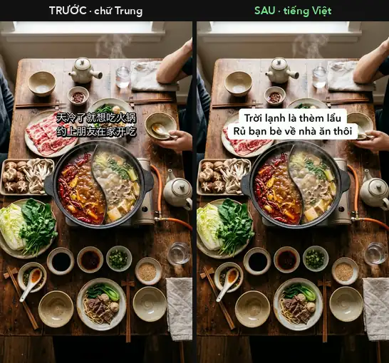

# Hardsub Translator: remove and translate burned-in Chinese subtitles in videos

**Free, offline hardsub remover and translator for macOS.** It finds the hardcoded (burned-in) Chinese subtitles in a video, erases them, and writes your translation (Vietnamese, English or any Latin-script language) in the same place and at the same frame. Then it checks every frame to make sure no Chinese text is left.

Built for creators who re-edit **Douyin / Xiaohongshu / Bilibili** clips for **TikTok, Reels and YouTube Shorts**, and for anyone who wants to **vietsub** a Chinese video without retyping the subtitles by hand.

[](LICENSE)   

[Tiếng Việt ↓](#tiếng-việt) · [中文说明](README_zh.md)

<p align="center">
  
  <br><sub>Left: original video with burned-in Chinese subtitles. Right: output of <code>./dich.sh render</code>. Every frame verified clean. (Demo footage is AI-generated for illustration.)</sub>
</p>

---

## Features

- **Automatic subtitle detection (OCR).** Apple Vision reads Simplified and Traditional Chinese on-device. No cloud, no API key, no cost.
- **Frame-accurate timing.** Each subtitle line is tracked frame by frame, so new text appears and disappears exactly when the original did.
- **Clean subtitle removal.** Only the subtitle strokes are inpainted (OpenCV), so the background is kept wherever it is visible.
- **TikTok-style captions.** Black text on a white rounded box (default) or white text with a dark outline. Long lines shrink to fit, and one font size is used across the whole video.
- **Ignores text on objects.** Brand names on pans, labels and packaging are not subtitles. They are detected and left alone, because real subtitles have a dark outline and printed text does not.
- **Self-verification.** After rendering, it re-checks all frames for leftover Chinese strokes, re-runs OCR on the output, and builds before/after comparison sheets.
- **Spreadsheet translation.** Captions are exported to `dich.tsv`. Translate them in Excel or Numbers, by hand, with a translator, or with an AI assistant, then import.
- **Any video length.** Resolution, FPS and duration are read automatically. Audio is kept untouched.

Real run: a 2-minute 720×1280 Douyin cooking video with 50 subtitles took about 40 s to detect, about 2 min to render and about 1.5 min to verify on an Apple Silicon Mac. The result had **0 of 3,716 frames** with leftover Chinese subtitles.

## How it compares

There are great open-source tools in this space. Pick the one that fits your setup:

| | **Hardsub Translator** | [video-subtitle-remover](https://github.com/YaoFANGUK/video-subtitle-remover) | [VideoSubtitleRemover Pro](https://github.com/SysAdminDoc/VideoSubtitleRemover) | [SubErase-Translate-Embed](https://github.com/chenwr727/SubErase-Translate-Embed) |
|---|---|---|---|---|
| Removes burned-in subtitles | ✅ classic inpainting | ✅ AI inpainting (STTN / LaMa / ProPainter) | ✅ AI inpainting | ✅ AI inpainting (STTN) |
| Writes translated captions in the same place and time | ✅ | ❌ removal only | ✅ re-burns a translated SRT | ✅ |
| Platform | macOS | Windows / macOS / Linux / Docker | Windows | Linux (install uses CUDA builds) |
| GPU | Not needed | Optional (CUDA / DirectML), CPU mode available | Optional NVIDIA build | Expected (CUDA) |
| Automatic check of the output for leftover subtitles | ✅ every frame | not mentioned in README | not mentioned in README | not mentioned in README |

**Choose Hardsub Translator** if you are on a Mac, want something light that runs offline in minutes, and your video uses the common white-with-outline Douyin subtitle style.
**Choose an AI-inpainting tool** if you need the cleanest possible erase on busy, fast-moving backgrounds and have a GPU.

## How it works

```
video.mp4 ─▶ 1. detect ─▶ dich.tsv ─▶ 2. translate ─▶ 3. render ─▶ out.mp4 ─▶ 4. verify
             OCR 5 fps      (you)                       inpaint +              per-frame check
             + per-frame                                new captions           + OCR + sheets
             timing
```

1. **Detect.** Sample 5 frames per second, run Apple Vision OCR in parallel, and group lines with the same position and text into tracks. Each start and end is then refined to the exact frame by matching the subtitle's white-on-dark stroke pattern.
2. **Translate.** Fill the `vi` column of `dich.tsv`. It works for any target language, not only Vietnamese.
3. **Render.** Erase the white subtitle pixels plus their outline (TELEA inpainting) and draw the new caption, rendered at 2× and downscaled for crisp edges. The video is exported in **one pass** with the original audio.
4. **Verify.** The exit code is non-zero if any original subtitle is still visible.

## Requirements

- macOS. Apple Vision OCR and system fonts are used. Tested on macOS 26 with Apple Silicon.
- Python 3, `ffmpeg` (`brew install ffmpeg`), Xcode Command Line Tools (`xcode-select --install`).

## Install

```bash
git clone https://github.com/michael-tpm/hardsub-translator.git
cd hardsub-translator
./setup.sh
```

## Quick start

```bash
# 1. detect subtitles → my_video_work/ (captions.json, review sheets, dich.tsv)
./dich.sh detect ~/Videos/my_video.mp4

# 2. open ~/Videos/my_video_work/dich.tsv, fill the "vi" column, save, then:
./dich.sh import ~/Videos/my_video_work

# 3. render the translated video
./dich.sh render ~/Videos/my_video_work ~/Videos/my_video_translated.mp4

# 4. verify: no Chinese subtitle left + before/after sheets in my_video_work/verify/
./dich.sh verify ~/Videos/my_video_work ~/Videos/my_video_translated.mp4
```

Options:

- `STYLE=vien ./dich.sh render …` gives white outlined text instead of the white box.
- `FPS=3 ./dich.sh detect …` gives faster detection for long videos. The default of 5 catches subtitles as short as about 0.3 s.

### Translation table (`dich.tsv`)

| Column | Meaning |
|---|---|
| `cau`, `dong` | Caption number and line number. Do not edit. |
| `start`, `end` | Time in seconds. Edit to extend a fading caption, for example. |
| `zh` | Chinese text read by OCR, for reference. |
| `vi` | **Your translation.** Use `\n` for a line break. Empty means erase only. |
| `bo_qua` | `x` means not a subtitle, keep as is. Suspicious lines are pre-marked. |
| `xoa_vung` | `x` means erase the whole text box. Use it for fading or animated text and emoji next to the subtitle. |

### Use with Claude Code (optional)

The repo ships a slash command at `.claude/commands/hardsub.md`. Open the folder in Claude Code and run `/hardsub path/to/video.mp4` to detect, translate, render and verify automatically. The tool itself does **not** need any AI.

## Roadmap

- [ ] Windows and Linux support (RapidOCR as an alternative to Apple Vision)
- [ ] Optional AI inpainting (LaMa) for complex backgrounds
- [ ] Built-in machine translation (optional API) with a glossary
- [ ] Coloured subtitles and subtitles on a solid box
- [ ] Korean, Japanese and English source subtitles
- [ ] Batch mode for a whole folder

Ideas and pull requests are welcome. Open an issue to discuss.

## Limitations

- **Subtitle style.** It works on **white subtitles with a dark outline or shadow**, the most common Douyin style. Coloured subtitles need the colour threshold in `white_mask()` adjusted.
- **Source language.** Chinese, Simplified and Traditional.
- **Target languages.** Latin-script languages, such as Vietnamese, English, Spanish or Indonesian, via the bundled macOS fonts.
- **Text on objects.** Chinese printed on objects is intentionally kept.
- **Platform.** macOS only, because of Apple Vision.

## FAQ

**How do I remove hardcoded Chinese subtitles from a video for free?**
Run `./dich.sh detect`, leave the `vi` column empty, then run `import`, `render` and `verify`. The subtitles are erased without new text.

**Can I translate Douyin videos to Vietnamese (vietsub) or English?**
Yes. Put the translation in the `vi` column. The column name stays the same for any language.

**Does it upload my video anywhere?**
No. Everything runs locally: Apple Vision, OpenCV and ffmpeg.

**Is the original video modified?**
No. A new file is written.

**Is there a lightweight video-subtitle-remover alternative for Mac that also translates?**
Yes, this tool. It uses Apple Vision and OpenCV on the CPU, with no model downloads. A 2-minute 720p video takes a few minutes end to end.

**Can it translate automatically?**
The tool itself does not call any translation service. Fill `dich.tsv` by hand, paste it into any translator or AI chat, or use the included Claude Code command `/hardsub`, which translates and verifies for you.

**Does it work with Japanese or Korean subtitles?**
Not yet. Chinese (Simplified and Traditional) only for now. Other source languages are on the roadmap.

**What subtitle styles are supported?**
White text with a dark outline or shadow, the default style on Douyin and most Chinese short-video apps.

Please only process videos you have the right to edit and re-publish.

---

## Tiếng Việt

# Hardsub Translator: xóa chữ Trung Quốc trên video và thay bằng tiếng Việt (vietsub tự động)

**Công cụ miễn phí, chạy offline trên macOS.** Công cụ tự tìm phụ đề tiếng Trung dính cứng trên video (hardsub), xóa đi, rồi ghi chữ tiếng Việt đúng vị trí và đúng từng khung hình. Sau đó nó tự kiểm tra lại từng khung để chắc không còn sót chữ Trung.

Dành cho người làm nội dung lấy video **Douyin, Xiaohongshu (Tiểu Hồng Thư), Bilibili** để đăng lại lên **TikTok, Reels, YouTube Shorts**, và cho ai cần **vietsub video Trung Quốc** mà không muốn gõ lại phụ đề bằng tay.

<p align="center"></p>

### Tính năng

- **Tự đọc chữ Trung (OCR)** bằng Apple Vision có sẵn trong máy Mac: không cần internet, không cần API key, không tốn phí.
- **Khớp thời gian từng khung hình.** Chữ Việt hiện và tắt đúng lúc chữ Trung gốc hiện và tắt.
- **Xóa chữ sạch.** Chỉ tô lại các nét chữ phụ đề, nền video giữ nguyên.
- **Phụ đề kiểu TikTok.** Chữ đen trên nền trắng bo góc (mặc định), hoặc chữ trắng viền đen (`STYLE=vien`).
- **Không xóa nhầm.** Chữ in trên đồ vật như nồi, khay, bao bì được giữ nguyên.
- **Tự kiểm tra.** Soát từng khung, đọc lại chữ trên video kết quả, và làm ảnh so sánh trước/sau.
- **Dịch trên bảng tính.** Bản dịch nằm trong `dich.tsv`, mở được bằng Excel hoặc Numbers.
- **Mọi độ dài video.** Công cụ tự đọc độ phân giải, số khung/giây và thời lượng. Âm thanh giữ nguyên.

### Cài đặt và sử dụng

```bash
git clone https://github.com/michael-tpm/hardsub-translator.git
cd hardsub-translator
./setup.sh                                   # cài 1 lần (cần ffmpeg + Xcode Command Line Tools)

./dich.sh do   video.mp4                     # B1: dò chữ Trung → video_work/dich.tsv
#   mở video_work/dich.tsv, điền tiếng Việt vào cột "vi"
./dich.sh nhap video_work                    # B2: nạp bản dịch
./dich.sh xuat video_work video_viet.mp4     # B3: xuất video tiếng Việt
./dich.sh kiem video_work video_viet.mp4     # B4: kiểm tra còn sót chữ Trung không
```

Lệnh tiếng Việt (`do / nhap / xuat / kiem`) và tiếng Anh (`detect / import / render / verify`) dùng như nhau.

### Câu hỏi thường gặp

**Làm sao xóa chữ Trung Quốc trên video miễn phí?** Chạy B1, để trống cột `vi`, rồi chạy B2 đến B4. Chữ Trung bị xóa và không ghi chữ mới.

**Video Douyin dài ngắn khác nhau có dùng được không?** Được, công cụ tự đọc thông số video.

**Có cần AI hay internet không?** Không. Mọi thứ chạy trên máy. Bước dịch thì bạn tự điền, hoặc nhờ công cụ dịch hay AI tùy ý.

**Video gốc có bị sửa không?** Không. Công cụ luôn tạo file mới.

**Có công cụ nào nhẹ hơn video-subtitle-remover, chạy trên Mac mà còn dịch được không?** Có, chính công cụ này. Không cần card đồ họa hay tải mô hình AI. Video 720p dài 2 phút xử lý trong vài phút.

**Có tự dịch được không?** Công cụ không tự gọi dịch vụ dịch nào. Bạn tự điền `dich.tsv`, dán vào Google Dịch, ChatGPT hoặc Claude, hoặc dùng lệnh `/hardsub` trong Claude Code để dịch và kiểm tra tự động.

**Giới hạn:** chỉ chạy trên macOS. Chỉ xử lý được phụ đề chữ trắng có viền hoặc bóng tối (kiểu phổ biến trên Douyin).

Chỉ xử lý video bạn có quyền chỉnh sửa và đăng lại.

## License

[MIT](LICENSE) © 2026 michael-tpm
