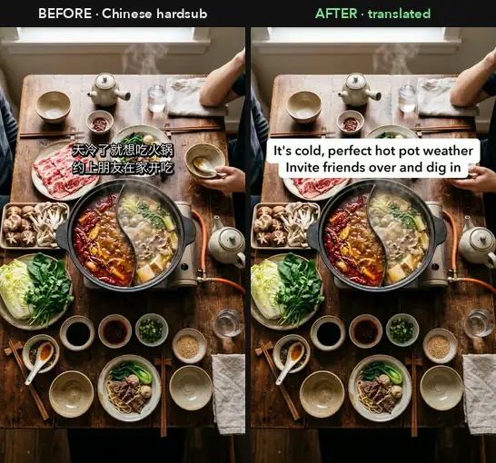

# Hardsub Translator：视频硬字幕去除 + 翻译替换（macOS 本地离线）

[English](README.md) · 中文

**免费、离线运行的 macOS 视频硬字幕翻译工具。** 自动识别视频中烧录的中文字幕（硬字幕），擦除原字幕，然后在原位置、按原时间轴写入你的译文（越南语、英语或其他拉丁字母语言）。最后逐帧检查，确保没有残留的中文字幕。

适合把**抖音、小红书、B站**短视频翻译后发布到 **TikTok、Instagram Reels、YouTube Shorts** 的创作者。

<p align="center"></p>

## 功能

- **自动识别字幕（OCR）**：使用 macOS 自带的 Apple Vision 识别简体和繁体中文。无需联网，无需 API Key，免费。
- **逐帧对齐时间轴**：新字幕的出现和消失与原字幕完全同步。
- **只擦除字幕笔画**：用 OpenCV 修复字幕笔画，尽量保留背景。
- **TikTok 风格字幕**：默认白色圆角底加黑字；也可选白字黑边（`STYLE=vien`）。
- **不误删实物上的文字**：锅具、包装上印的中文不是字幕，会自动识别并保留。
- **自动验收**：渲染后逐帧检查是否残留原字幕，并对输出重新 OCR，生成前后对比图。
- **表格翻译**：字幕导出为 `dich.tsv`，可用 Excel/Numbers 编辑，也可交给翻译工具或 AI。

实测：一段 2 分钟 720×1280 的抖音美食视频（50 条字幕），在 Apple Silicon Mac 上识别约 40 秒、渲染约 2 分钟、验收约 1.5 分钟，**3716 帧中 0 帧残留**。

## 安装

需要 macOS、Python 3、`ffmpeg`（`brew install ffmpeg`）和 Xcode Command Line Tools（`xcode-select --install`）。

```bash
git clone https://github.com/michael-tpm/hardsub-translator.git
cd hardsub-translator
./setup.sh
```

## 使用

```bash
./dich.sh detect 视频.mp4                       # 1. 识别字幕 → 视频_work/dich.tsv
# 打开 视频_work/dich.tsv，在 "vi" 列填写译文（任何语言都填这一列）
./dich.sh import 视频_work                      # 2. 导入译文
./dich.sh render 视频_work 输出.mp4             # 3. 渲染
./dich.sh verify 视频_work 输出.mp4             # 4. 验收：检查是否残留中文字幕
```

只想**去字幕不加新字幕**：`vi` 列留空即可。

## 限制

- 目前仅支持 macOS（依赖 Apple Vision）。
- 适用于**白字 + 深色描边/阴影**的字幕（抖音最常见样式）。
- 源语言目前仅中文。

如果你需要在复杂、快速运动的背景上获得最干净的擦除效果，并且有 GPU，推荐 AI 修复工具 [video-subtitle-remover](https://github.com/YaoFANGUK/video-subtitle-remover)。

请仅处理你有权编辑和再发布的视频。

[MIT](LICENSE) © 2026 michael-tpm
